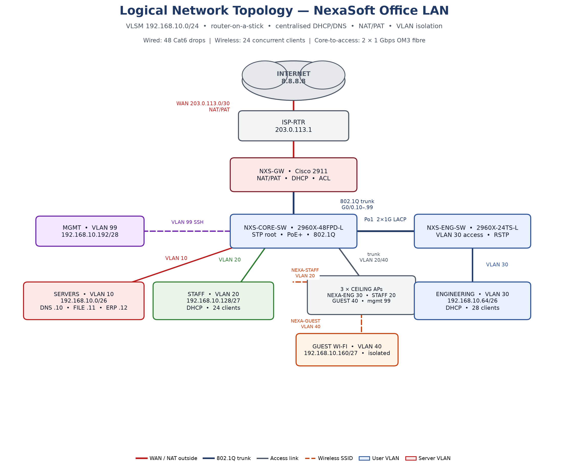
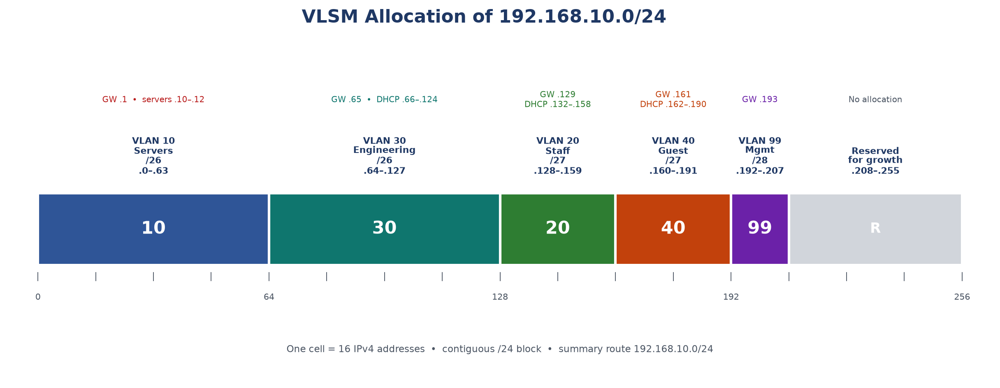

# NexaSoft Office LAN — Computer Networks Mini Project

Design of a local area network for a small office: architecture, IP addressing and cost analysis.

The site is a 2,800 sq ft office floor with 48 wired drops, up to 24 concurrent wireless clients and a 100 Mbps internet link. Site details are anonymised.



## Design summary

- **Architecture:** collapsed-core, two-tier. One Cisco 2911 router, a 48-port PoE core switch, a 24-port engineering access switch and three ceiling access points.
- **Routing:** router-on-a-stick over an 802.1Q trunk, with NAT/PAT to a single public address.
- **Services:** DHCP per VLAN on the router, internal DNS server, guest and management ACLs.
- **Resilience:** 2 × 1 Gbps LACP fibre uplink between the switches, Rapid PVST+, UPS-backed core.

### Addressing plan (VLSM on 192.168.10.0/24)

| VLAN | Name | Subnet | Gateway | Use |
|---|---|---|---|---|
| 10 | Servers | 192.168.10.0/26 | .1 | DNS, file/backup and ERP servers (static) |
| 30 | Engineering | 192.168.10.64/26 | .65 | Engineering PCs, printer, engineering Wi-Fi |
| 20 | Staff | 192.168.10.128/27 | .129 | Admin, HR, finance, management, staff Wi-Fi |
| 40 | Guest | 192.168.10.160/27 | .161 | Guest Wi-Fi, internet only, client isolation |
| 99 | Management | 192.168.10.192/28 | .193 | Router, switches, access points |

`192.168.10.208–255` is left unallocated for growth.



### Cost

| Item | Amount (Rs.) |
|---|---|
| Bill of materials | 542,700 |
| Contingency (5%) | 27,135 |
| **Total CapEx** | **569,835** |
| Annual OpEx | 192,920 |
| 3-year total cost of ownership | 1,148,595 |

Figures are budgetary estimates, not vendor quotations.

## Validation

Cisco Packet Tracer and physical hardware were not used. The design is checked with a Python packet-flow model (`04_Simulation/network_model.py`) that tests DHCP allocation, DNS, inter-VLAN routing, ACL decisions, NAT/PAT and guest isolation.

The last run passed 18 of 18 tests, with 64 unique DHCP leases and 2 PAT translations. The model checks design logic only; it does not emulate IOS, spanning tree, PoE or radio coverage. The Cisco configuration files are deployment templates that have not been run on a device.

## Repository layout

| Folder | Contents |
|---|---|
| `01_Site_Survey` | Floor plan with drop and access point positions |
| `02_Network_Design` | Logical topology and VLSM map |
| `03_Configuration` | Router and switch config templates, SSID plan, port map |
| `04_Simulation` | Validation model and its output (leases, NAT table, DNS log, test results, packet trace) |
| `05_Cost_Analysis` | Bill of materials workbook and cost chart |
| `06_Scripts` | Scripts that generate every figure, config, workbook and the report |

## Regenerating the artifacts

Requires Python 3 with `matplotlib`, `openpyxl` and `python-docx`.

```bash
cd 06_Scripts
python make_figures.py
python generate_configs.py
python make_cost_workbook.py
python ../04_Simulation/network_model.py
python make_report.py
```

`project_data.py` is the single source for VLANs, addresses, rooms and the bill of materials; every other script reads from it.

The final report (DOCX/PDF) is not included in this repository. `make_report.py` builds it, and reads the cover-page student details from an optional `06_Scripts/student_details.json` with the keys `prn`, `roll` and `division`.

The passwords in the config templates are placeholders (`CHANGE_ME_...`) and must be replaced before any deployment.
